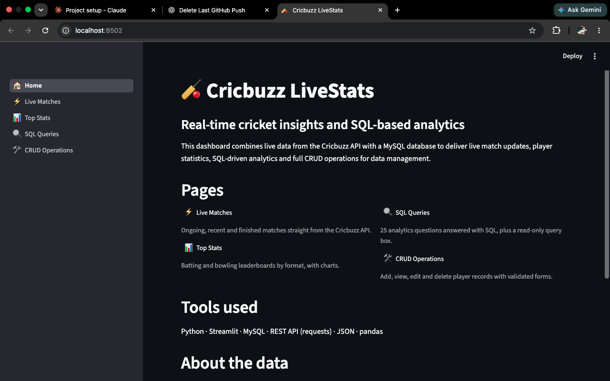
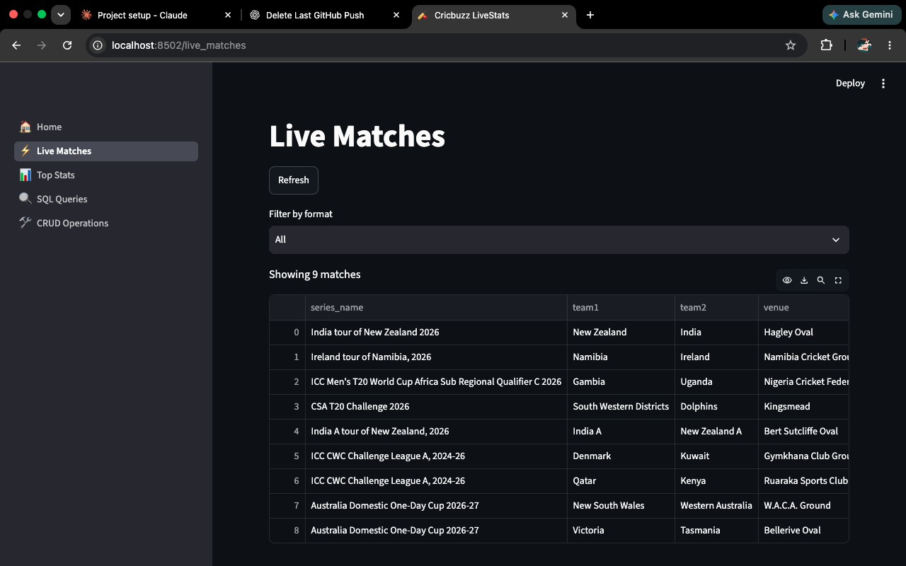
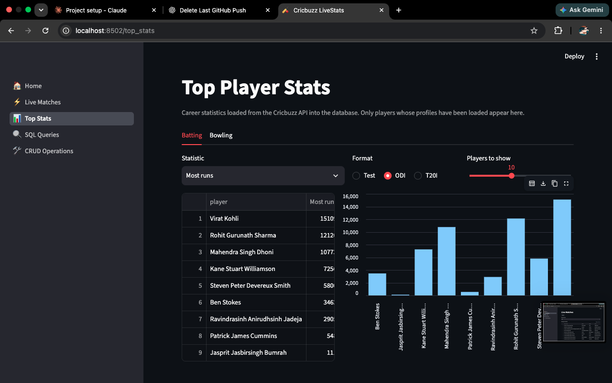
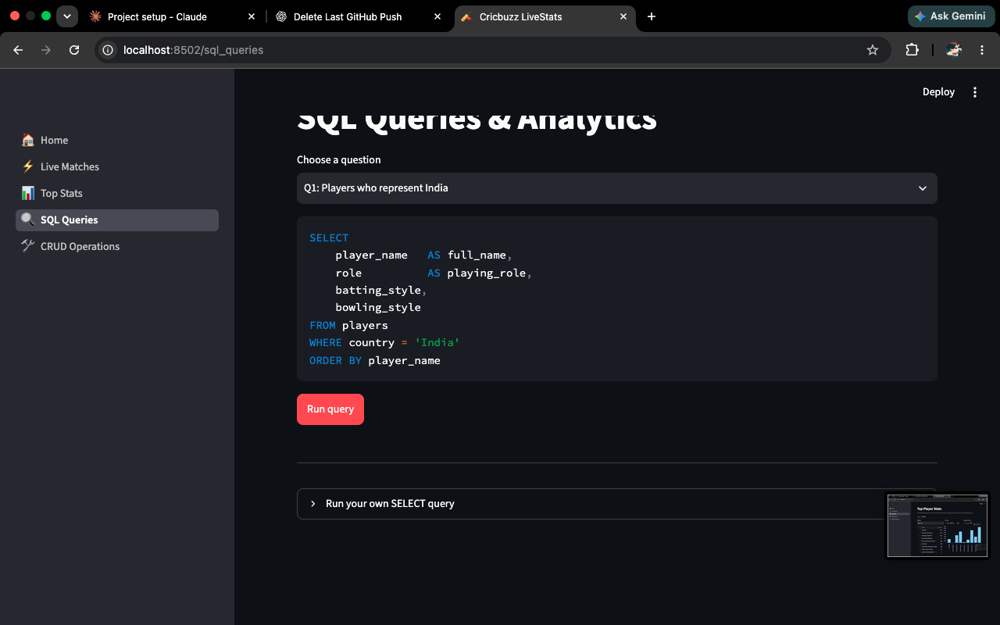
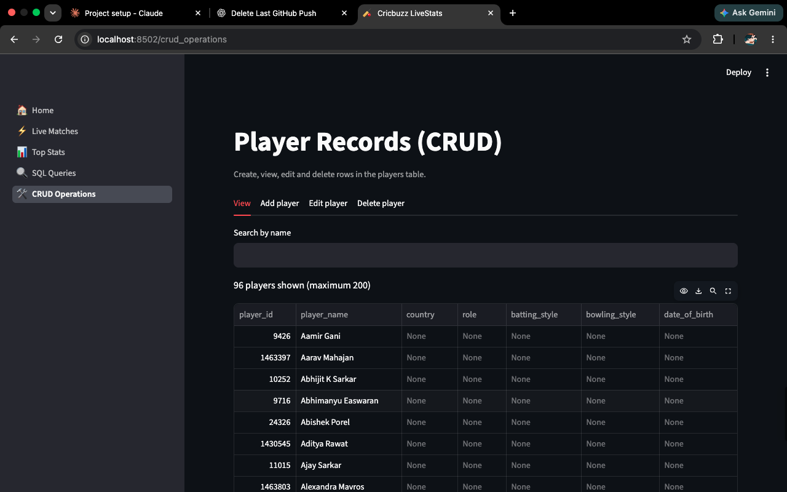
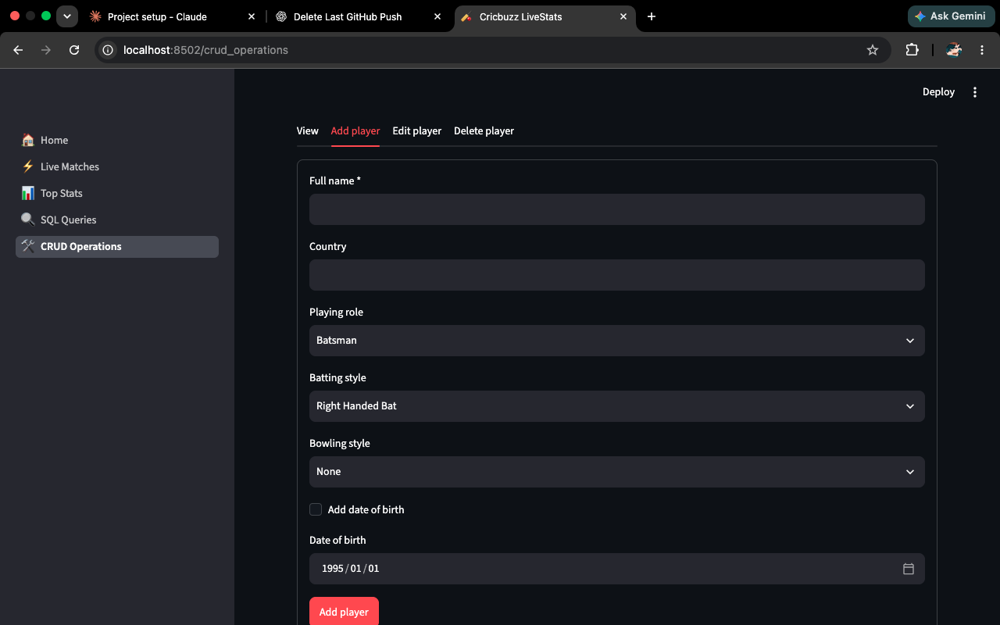
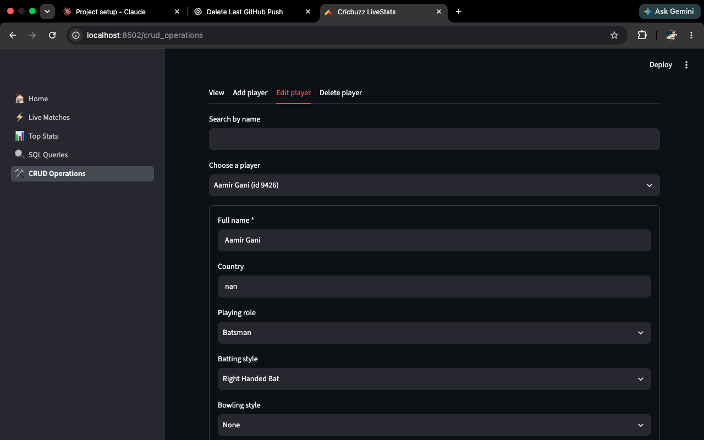
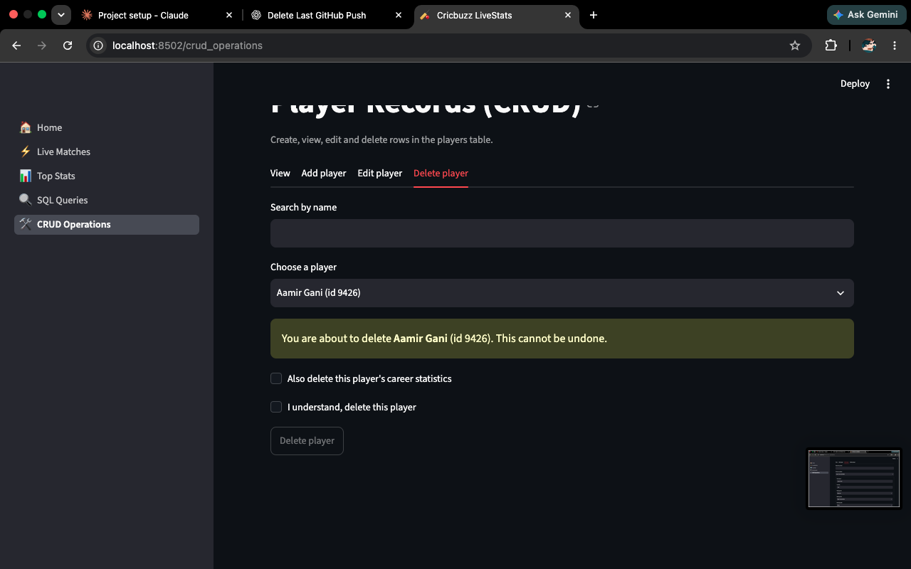

# 🏏 Cricbuzz LiveStats: Real-Time Cricket Insights & SQL-Based Analytics

A multi-page Streamlit dashboard that combines live data from the Cricbuzz Cricket API (via RapidAPI) with a MySQL database. It provides live match updates, player statistics, 25 SQL analytics questions, and full CRUD operations on player records.

**Skills:** Python · SQL · Streamlit · JSON · REST API · pandas

## Screenshots

### Home


### Live Matches


### Top Player Stats


### SQL Queries & Analytics


### CRUD Operations

**View player records**


**Add a player**


**Edit a player**


**Delete a player**


## Features

| Page | What it does |
|---|---|
| Home | Project overview, navigation and folder structure |
| Live Matches | Live, recent and finished matches from the Cricbuzz API, with a format filter |
| Top Stats | Batting and bowling leaderboards by format (Test, ODI, T20I) with charts |
| SQL Queries | Runs the 25 analytics questions from `sql/queries.sql`, plus a read-only custom `SELECT` box |
| CRUD Operations | Add, view, edit and delete player records with validation and transactions |

## Important note about the data

- **Real data (from the Cricbuzz API):** live matches, teams, venues, series, scorecards of a few completed matches, and profiles and career statistics of nine well-known players.
- **Seed data:** `sql/seed_venues.sql` adds venue capacities and countries (approximate public figures).
- **Synthetic sample data:** `generate_sample_data.py` creates 132 matches between four fictional teams ("Sample India", "Sample Australia", ...) so the advanced SQL questions (head-to-head, recent form, quarterly trends, toss analysis, partnerships) have enough rows to test. It is **not real cricket data**. All sample rows use IDs of 90,000,000 and above, and `python generate_sample_data.py --clean` removes them.

The free RapidAPI plan has a small request quota, so the project saves API responses in `data/` and reuses them instead of calling the API repeatedly.

## Project structure

```text
CricBuzz/
├── app.py                      # Streamlit entry point and navigation
├── requirements.txt
├── .env.example                # Template for the secrets file (.env)
├── pages/
│   ├── home.py
│   ├── live_matches.py
│   ├── top_stats.py
│   ├── sql_queries.py
│   └── crud_operations.py
├── utils/
│   ├── db_connection.py        # MySQL connection (credentials from .env)
│   ├── api_client.py           # Live matches: request + JSON parser
│   ├── db_loader.py            # Saves live matches into MySQL
│   ├── scorecard_parser.py     # Scorecard JSON -> rows
│   ├── scorecard_loader.py     # Saves a scorecard into MySQL
│   ├── player_parser.py        # Player profile / career JSON -> rows
│   └── player_loader.py        # Saves players into MySQL
├── sql/
│   ├── schema.sql              # CREATE TABLE statements
│   ├── seed_venues.sql         # Venue capacities and countries
│   ├── prepare_data.sql        # Winners, margins, team countries
│   └── queries.sql             # The 25 SQL analytics questions
├── load_players.py             # Batch-load player profiles and career stats
├── load_scorecard.py           # Download and save match scorecards
├── generate_sample_data.py     # Synthetic sample data generator
├── fetch_scorecard.py          # Save one scorecard JSON to data/
├── explore_api.py              # Call any API path and save the response
├── test_*.py                   # Small manual test scripts
├── data/                       # Saved API responses (cache)
├── notebooks/                  # Optional practice notebooks
└── cricbuzz_database_design.md # Database design notes
```

## Setup

### 1. Requirements

- Python 3.10 or newer
- MySQL 8.0 or newer (window functions are used in the advanced queries)
- A RapidAPI account subscribed to the **Cricbuzz Cricket** API (the free plan is enough)

### 2. Install

```bash
git clone <your-repository-url> CricBuzz
cd CricBuzz
python3 -m venv venv
source venv/bin/activate        # Windows: venv\Scripts\activate
python -m pip install -r requirements.txt
```

### 3. Configure secrets

Copy `.env.example` to `.env` and fill in your values:

```dotenv
RAPIDAPI_KEY=your_rapidapi_key_here
RAPIDAPI_HOST=cricbuzz-cricket.p.rapidapi.com
DB_HOST=localhost
DB_USER=root
DB_PASSWORD=your_mysql_password_here
DB_NAME=cricbuzz_db
```

`.env` is listed in `.gitignore` and must never be committed.

### 4. Create the database

```bash
mysql -u root -p -e "CREATE DATABASE cricbuzz_db;"
mysql -u root -p cricbuzz_db < sql/schema.sql
mysql -u root -p cricbuzz_db < sql/seed_venues.sql
```

### 5. Load data

Run these from the project root with the virtual environment active.

```bash
# Live matches (1 API call)
python test_db_loader.py

# Scorecards of completed matches (1 API call each)
python load_scorecard.py 168090 163721 163691 163761

# Player profiles and career statistics (up to 4 API calls per player)
python load_players.py

# Winners, margins and team countries derived from match status text
mysql -u root -p cricbuzz_db < sql/prepare_data.sql

# Synthetic sample data for the advanced SQL questions
python generate_sample_data.py
```

### 6. Run the app

```bash
streamlit run app.py
```

Always start the app from `app.py` in the project root, so that `from utils...` imports work on every page.

## Database design

Ten tables: `teams`, `venues`, `series`, `players`, `matches`, `team_innings`, `batting_innings`, `bowling_innings`, `partnerships` and `player_career_stats`. Cricbuzz IDs are used as primary keys, so reloading data updates rows (`INSERT ... ON DUPLICATE KEY UPDATE`) instead of duplicating them. See `cricbuzz_database_design.md` for the full design, relationships and indexes.

## SQL questions

All 25 questions are in `sql/queries.sql` (beginner Q1–Q8, intermediate Q9–Q16, advanced Q17–Q25) and can be run from the **SQL Queries** page. Q18, Q22 and Q25 have more than one query (a career-statistics version, a venue breakdown and a career-phase summary). The advanced questions use window functions, CTEs and conditional aggregation.

## Error handling and security

- API calls use timeouts and catch request and JSON errors; failures return an empty result and the pages show a warning instead of crashing.
- Database writes use transactions: `commit` on success, `rollback` on error.
- All SQL that takes user input uses parameterized queries (`%s`).
- The custom query box on the SQL Queries page accepts `SELECT` and `WITH` queries only.
- API keys and database credentials are read from `.env`, which is git-ignored.

## Known limitations

- The free API quota limits how much real data can be loaded, which is why synthetic sample data is used for the advanced analytics.
- `catches` and `stumpings` are not provided by the API, so fielding points in Q21 are 0 for the loaded players.
- Some columns the live API does not provide (series dates, toss details) are empty for real matches. They are filled only for the sample data.

## Future improvements

- Store series dates and toss details when loading real matches.
- Load more players and matches as API quota allows.
- Add charts to the SQL Queries page and a Docker setup.
- Deploy the app (for example, on Streamlit Community Cloud with a hosted MySQL database).
